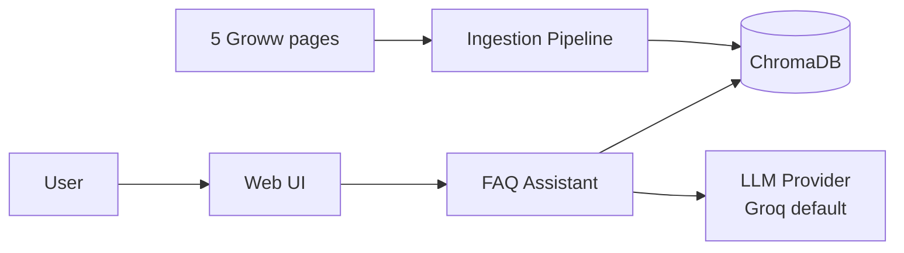
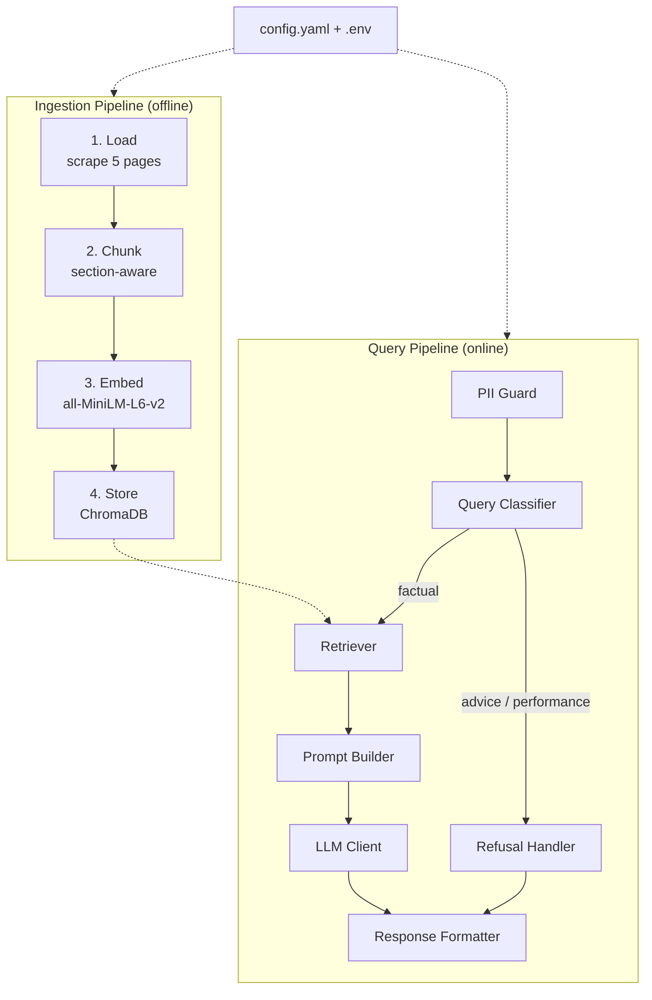
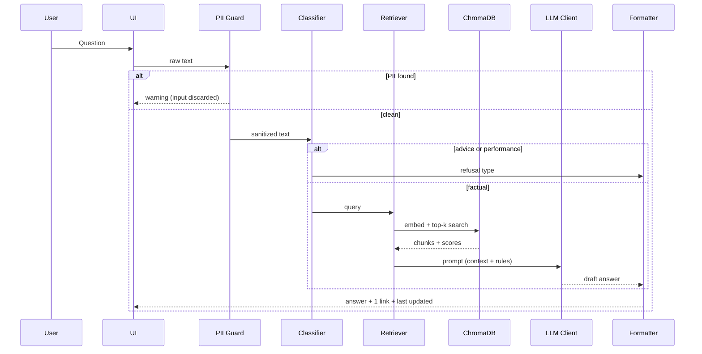
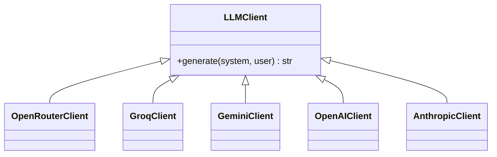

# Architecture: Mutual Fund FAQ Assistant (RAG Demo)

| | |
|---|---|
| **Derived from** | PRD.md v1.0 |
| **Status** | Draft v1.0 |

---

## 1. Purpose

This document describes how the facts-only MF FAQ assistant is built: components, data flow, storage, interfaces, configuration and error handling. The design has two goals:

1. Answer factual questions about 5 Groww HDFC MF pages with exactly one citation each.
2. Make every RAG stage **explicit and inspectable** by persisting its output.

## 2. System Context



Two independent runtimes share the same config, embedding model and vector DB:

| Runtime | Trigger | Purpose |
|---|---|---|
| **Ingestion pipeline** (offline) | Manual CLI run | Load, chunk, embed and store the corpus |
| **Query pipeline** (online) | User question | Guard, classify, retrieve, generate, format |

## 3. High-Level Architecture



## 4. Ingestion Pipeline

Each stage reads the previous stage's artifact from disk, so stages can be run and shown independently.

### 4.1 Stage 1: Data Loading

| Item | Detail |
|---|---|
| Input | `data/sources.csv` (the 5 URLs) |
| Process | HTTP fetch, with headless-browser fallback if the page is JS-rendered; strip nav/ads/scripts; extract visible text |
| Rule | No internal links are followed |
| Output (raw) | `data/raw/<slug>.html` |
| Output (clean) | `data/processed/<slug>.json` |

Clean record schema:
```json
{
  "doc_id": "hdfc-large-cap-fund-direct-growth",
  "scheme_name": "HDFC Large Cap Fund Direct Growth",
  "source_url": "https://groww.in/mutual-funds/hdfc-large-cap-fund-direct-growth",
  "page_type": "scheme",
  "scraped_at": "2026-11-06T10:00:00Z",
  "sections": [{"title": "Expense ratio & exit load", "text": "..."}]
}
```

### 4.2 Stage 2: Data Chunking

Strategy is chosen by page type and set in config.

| Page type | Strategy |
|---|---|
| Scheme page | **Section-aware**: one chunk per logical block (fund details, expense ratio, exit load, min investment, riskometer, benchmark, FAQs) |
| AMC overview | Section-aware, then recursive split for long lists |
| Any oversized section | Recursive character split with overlap |

- Each chunk is self-contained: the scheme name is prepended to the text so retrieval works even for short chunks.
- Output: `data/chunks/chunks.jsonl`

Chunk schema:
```json
{
  "chunk_id": "hdfc-large-cap-fund-direct-growth::exit-load::0",
  "text": "HDFC Large Cap Fund Direct Growth - Exit load: ...",
  "metadata": {
    "source_url": "https://groww.in/...",
    "scheme_name": "HDFC Large Cap Fund Direct Growth",
    "section": "exit-load",
    "page_type": "scheme",
    "scraped_at": "2026-11-06T10:00:00Z"
  }
}
```

### 4.3 Stage 3: Data Embedding

| Item | Detail |
|---|---|
| Model | `sentence-transformers/all-MiniLM-L6-v2` (from config) |
| Dimension | 384 |
| Normalisation | L2-normalised, cosine similarity |
| Output | `data/embeddings/embeddings.npy` plus `ids.json` |

### 4.4 Stage 4: Vector Store

| Item | Detail |
|---|---|
| DB | ChromaDB, persistent client at `data/chroma/` |
| Collection | `hdfc_mf_faq` (from config) |
| Stored per record | id, embedding, document text, metadata |
| Idempotency | Re-running ingestion drops and recreates the collection |
| Verification | A smoke-test script runs sample queries and prints top hits |

## 5. Query Pipeline



### 5.1 PII Guard
- Regex checks for PAN, Aadhaar (12 digits), account-like numbers, OTP-like codes, emails and phone numbers.
- On match: the input is dropped, a short warning is shown, and **nothing is logged or stored**.

### 5.2 Query Classifier

| Class | Detection | Action |
|---|---|---|
| `factual` | Default if in scope | Retrieve and answer |
| `advice` | Keywords/intent such as "should I", "best", "buy", "sell", "invest in" | Refuse with educational link |
| `performance` | "returns", "CAGR", "performance", "compare" | Refuse to compute, link factsheet |
| `out_of_scope` | Unrelated to MF facts | Polite scope message |

Approach: fast rule-based check first, then an LLM fallback for ambiguous queries.

### 5.3 Retriever
- Embeds the query with the same model as ingestion.
- Top-k similarity search (default `k=4`), with an optional metadata filter when a scheme name is detected in the query (e.g., "ELSS" maps to the ELSS page).
- Applies a minimum-score threshold; if nothing passes, the answer is "not found in sources".
- The citation URL is taken from the **metadata of the top-ranked chunk used**, never generated by the LLM.

### 5.4 Prompt Builder and LLM Client

System prompt rules:
1. Answer only from the provided context.
2. Maximum 3 sentences.
3. No advice, no recommendations, no return calculations.
4. If the answer is not in the context, say so.
5. Do not output URLs (the formatter adds them).

LLM client is a thin provider abstraction. OpenRouter is the default and uses the OpenAI-compatible endpoint at `https://openrouter.ai/api/v1`; its API key is `OPENROUTER_API_KEY` and the model ID comes from `LLM_MODEL`. Client creation is lazy so the UI can start before a key is entered; generation reports a clear error if the selected key is missing.



Provider and model are chosen from `config.yaml` and `.env`. Default: OpenRouter with the model ID from `LLM_MODEL`. `LLM_PROVIDER` can override the config provider. The key is required when generating an answer, not for rendering the UI.

### 5.5 Response Formatter

Final response always has this shape:

```
<answer, 3 sentences or fewer>
Source: <one URL>
Last updated from sources: <scraped_at date>
```

Post-checks enforce: sentence count, exactly one URL, last-updated line present. If the LLM output violates these, it is truncated or regenerated once, then falls back to a safe template.

### 5.6 Refusal Handler

| Case | Message pattern | Link |
|---|---|---|
| Advice | "I can only share facts about schemes, not advice on whether to buy or sell." | AMFI/SEBI investor education page |
| Performance | "I don't calculate or compare returns. The official factsheet has this." | Scheme factsheet link |
| PII | "Please don't share personal or account details. I've ignored that message." | None |

## 6. UI Layer

| Element | Detail |
|---|---|
| Framework | Streamlit or Gradio |
| Static content | Welcome line, 3 clickable example questions, "Facts-only. No investment advice." note |
| Dynamic content | Answer, citation link, last-updated line |
| Demo mode | Expandable "RAG internals" panel showing classification, retrieved chunks with scores and the final prompt |

### 6.1 UI design reference

The Stitch design archive is `docs/stitch_groww_inspired_fintech_ui.zip` (`code.html`, `screen.png`, `DESIGN.md`). The prototype adapts its mobile-first Inter typography, white/slate surfaces, mint accents, rounded chat cards, suggestion chips, and generous touch targets. Portfolio holdings, market analysis, returns, buy/sell actions, and advice shown in the reference mock are intentionally excluded: the assistant is facts-only and shows public-source citations instead.

## 7. Data Stores and Artifacts

| Stage | Location | Format |
|---|---|---|
| Sources | `data/sources.csv` | CSV |
| Raw pages | `data/raw/` | HTML |
| Clean text | `data/processed/` | JSON |
| Chunks | `data/chunks/chunks.jsonl` | JSONL |
| Embeddings | `data/embeddings/` | NPY + JSON |
| Vector DB | `data/chroma/` | ChromaDB persistent |
| Query traces (demo) | `logs/queries.jsonl` | JSONL, PII-free |

## 8. Configuration

Everything swappable lives in `config.yaml` and `.env`.

```yaml
chunking:
  strategy: section_aware
  chunk_size: 500
  chunk_overlap: 50
embedding:
  model: sentence-transformers/all-MiniLM-L6-v2
vector_db:
  provider: chroma
  persist_dir: data/chroma
  collection: hdfc_mf_faq
retrieval:
  top_k: 4
  min_score: 0.30
llm:
  provider: groq
  max_sentences: 3
```

`.env` holds `LLM_PROVIDER`, `LLM_MODEL`, and provider keys (`OPENROUTER_API_KEY`, `GROQ_API_KEY`, `GEMINI_API_KEY`, `OPENAI_API_KEY`, `ANTHROPIC_API_KEY`). Never commit `.env`; `.env.example` contains blank keys only.

**Consistency rule:** the retriever reads the embedding model and collection from the same config keys as ingestion. If the collection was built with a different model, startup fails with a clear message.

## 9. Project Structure

```
mf-faq-assistant/
├── config.yaml
├── .env.example
├── requirements.txt
├── data/ (sources.csv, raw, processed, chunks, embeddings, chroma)
├── src/
│   ├── config.py
│   ├── ingestion/ (load.py, chunk.py, embed.py, store.py, run_all.py)
│   ├── retrieval/ (pii_guard.py, classifier.py, retriever.py)
│   ├── llm/ (base.py, groq_client.py, gemini_client.py, ...)
│   ├── pipeline.py        # orchestrates the query flow
│   ├── formatter.py
│   └── app.py
├── samples/sample_qa.md
├── docs/disclaimer.md
├── PRD.md
├── architecture.md
└── README.md
```

## 10. Security and Privacy

- Input is checked for PII before any processing; matches are never stored or logged.
- API keys only in `.env` (git-ignored); `.env.example` is committed.
- Only the 5 allowed URLs are fetched; no crawling.
- Logs contain only the sanitized query, classification and chunk IDs.

## 11. Error Handling

| Failure | Behaviour |
|---|---|
| Scrape fails or page is empty | Stage aborts with a clear error; previous artifacts are kept |
| Missing or invalid API key | Fail at startup with a readable message |
| LLM timeout or API error | One retry, then a friendly "try again" message with the top source link |
| No chunk above score threshold | "Not found in sources" plus the closest source link |
| Response format violation | Regenerate once, then use a safe template |
| Embedding model mismatch with stored collection | Refuse to start; prompt to re-ingest |

## 12. Testing

| Level | Checks |
|---|---|
| Ingestion | 5 pages loaded; chunk counts per page; every chunk has full metadata |
| Retrieval | For each fact type (expense ratio, exit load, min SIP, lock-in, riskometer, benchmark), the correct chunk is in the top-k |
| Behaviour | Advice and performance prompts are refused; PII prompts are rejected |
| Format | All answers have 3 sentences or fewer, one URL, and the last-updated line |
| Samples | `samples/sample_qa.md` holds 5-10 queries including at least one refusal |

## 13. Run Order

```
1. python -m src.ingestion.load      # data/raw, data/processed
2. python -m src.ingestion.chunk     # data/chunks
3. python -m src.ingestion.embed     # data/embeddings
4. python -m src.ingestion.store     # data/chroma
   (or: python -m src.ingestion.run_all)
5. streamlit run src/app.py
```

## 14. Hosting and Vercel

The checked-in UI is a Streamlit application and the ingestion creates a local persistent ChromaDB directory. Vercel's serverless functions do not host Streamlit's long-running server/websocket interaction or provide a durable local Chroma store, so the existing app must not be presented as a directly deployable Vercel project.

For the current implementation, deploy on a Streamlit-compatible host (for example Streamlit Community Cloud or Render) and provision the Python dependencies, corpus artifacts, and secrets there. For a Vercel deployment, first move the UI to a Vercel-supported frontend and host the Python retrieval API plus a persistent vector database separately. Configure `LLM_PROVIDER=openrouter`, `LLM_MODEL=<OpenRouter model ID>`, and `OPENROUTER_API_KEY` as backend-only secrets. Do not prefix API keys with `NEXT_PUBLIC_` or expose them to the browser. See `docs/deployment.md` for steps.

## 14. Known Limitations and Open Items

- Only 5 pages are in the corpus, so coverage is narrow. Questions such as statement downloads may need an extra source (see PRD open questions).
- Groww pages may be JS-rendered, which makes scraping fragile.
- Answers reflect the last scrape date, not live data.
- The model identifier `qwen/qwen3.8-27b` should be verified against Groq's model list.
